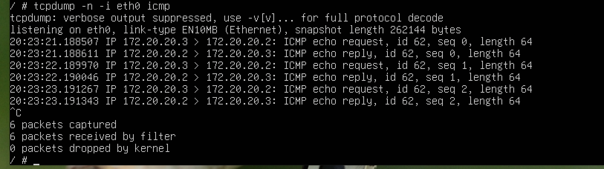

# Lab 01 — Two-Host Alpine Linux Network

**Started:** November 7, 2026  
**Status:** In Progress

## Objective

Deploy two Alpine Linux hosts, inspect their interfaces, and verify connectivity over a dedicated lab link separately from management network reachability.

## Environment

Ubuntu Server with Docker and Containerlab, using Alpine Linux containers named `host1` and `host2`. The topology used in the session was named `lab.clab.yaml`. The actual YAML is needed to reproduce the deployment.

## November 7, 2026 — Deployment and initial connectivity

### Commands recorded during the session

From the Ubuntu Server shell:

```sh
sudo containerlab deploy -t lab.clab.yaml
sudo docker exec -it clab-working-lab-host1 sh
```

From `host1`, the session pinged `172.20.20.2`. The destination was recorded. The exact flags, if any, were not recorded.

### Troubleshooting

The initial deployment encountered YAML syntax and link endpoint-format errors. The session corrected the YAML and the link endpoint format (`node:interface`), then deployed the topology successfully.

### Observations and results

| Check | Observation |
| --- | --- |
| Deployment | Both Alpine containers reached Running state. |
| Shell access | Opened an interactive shell on `host1` using `docker exec`. |
| ICMP | The ping to `172.20.20.2` received seven replies with 0% packet loss. |
| `host1` `eth0` | Observed IPv4 address `172.20.20.3/24`, consistent with the management network. |
| `host1` `eth1` | Observed an IPv6 link-local address and no configured IPv4 address. |

The successful ping established reachability to `172.20.20.2`.

## November 8, 2026 — ICMP capture on `eth0`

The earlier `ip route get 172.20.20.2` check selected `eth0` on `host1`. During the November 8 inspection, `eth1` was absent from the `host1` interface listing. This session verified ICMP on the management network. Dedicated-link verification remains pending.

In the Alpine shell on `host1`, install `tcpdump`, check its version, and start an ICMP capture on `eth0` with numeric addresses.

```sh
apk add tcpdump
tcpdump --version
tcpdump -n -i eth0 icmp
```

The installed version was **4.99.6**. With the capture running, open a second shell on `host1` and send three probes to `host2`.

```sh
ping -c 3 172.20.20.2
```

Stop the capture with Ctrl+C after the ping finishes.

| Packet type | Source | Destination | Count |
| --- | --- | --- | --- |
| ICMP Echo Request | `host1` (`172.20.20.3`) | `host2` (`172.20.20.2`) | 3 |
| ICMP Echo Reply | `host2` (`172.20.20.2`) | `host1` (`172.20.20.3`) | 3 |

All six packets carried ICMP ID `62` and showed `length 64` in `tcpdump`. Sequences `0`, `1`, and `2` each appeared once as a request and once as a reply. The reply copies the request's identifier and sequence number. With source and destination reversed, the identifier associates packets with the same ping run and the sequence number pairs each reply with its probe.



```text
6 packets captured
6 packets received by filter
0 packets dropped by kernel
```

The kernel drop counter measures packets lost in the local capture path because the capture buffer ran out of space. Ping measures how many probes went unanswered. All three probes received replies, so ping reported **0% packet loss**.

For defensive traffic analysis, this capture establishes a baseline for a normal ping exchange. Comparing request and reply directions, identifiers, and sequences helps identify unanswered probes. Checking the capture drop counter helps distinguish gaps in the recorded traffic from possible filtering or reachability problems.

## Next steps

- [ ] Check the topology and inspect both hosts to identify the dedicated-link endpoints.
- [ ] Once the endpoints are verified, assign IPv4 addresses on a subnet separate from management.
- [ ] Test ICMP to the peer's dedicated IPv4 address and verify the egress interface.
- [ ] Capture and analyze the ICMP test on the verified dedicated interface.
- [ ] Add the actual Containerlab YAML topology used for the lab.
- [ ] Complete the write-up with verified commands, observations, and results.
